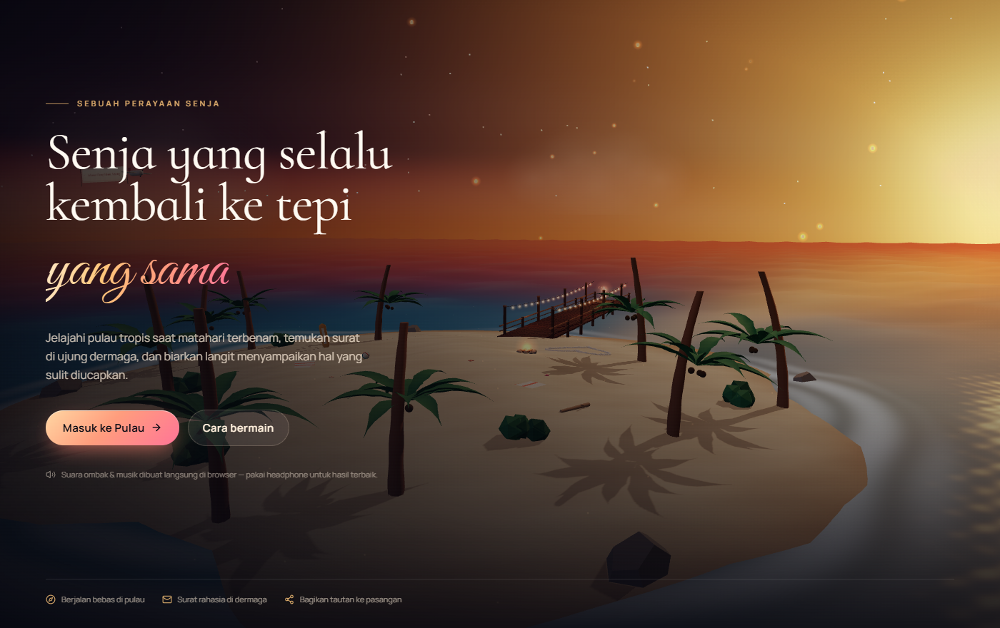
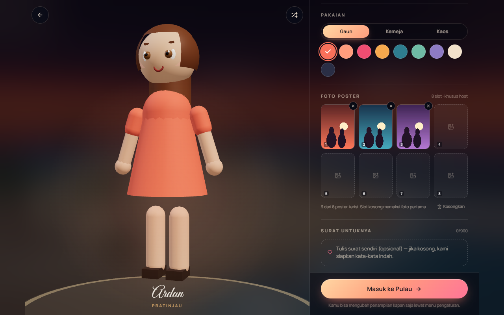
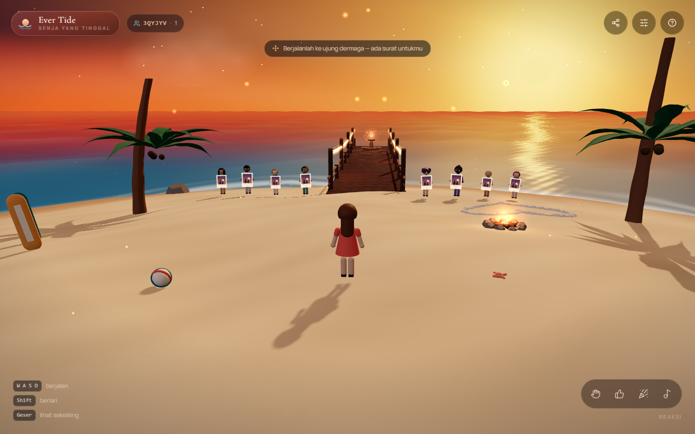
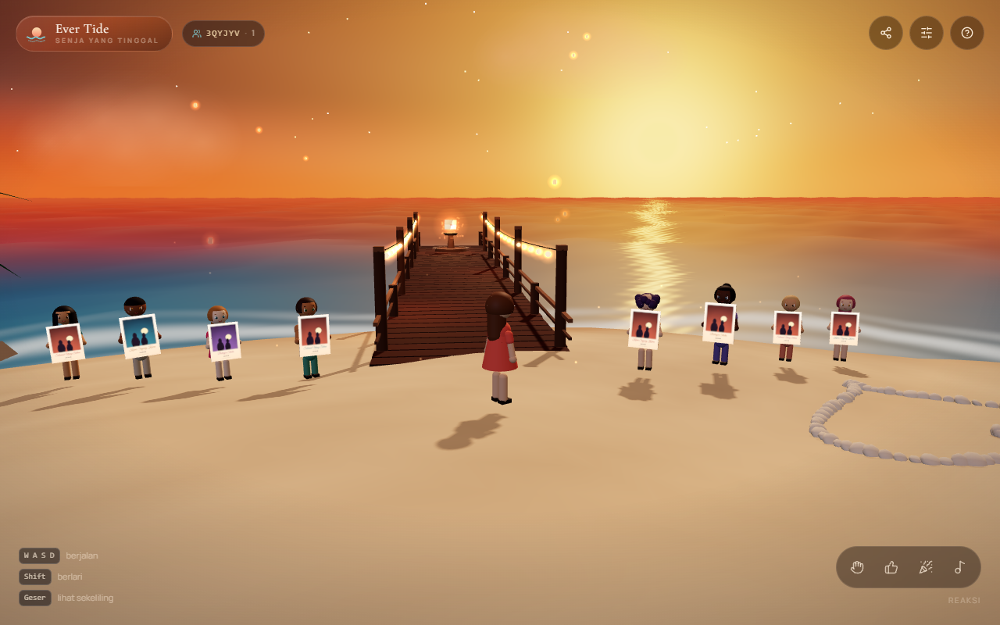
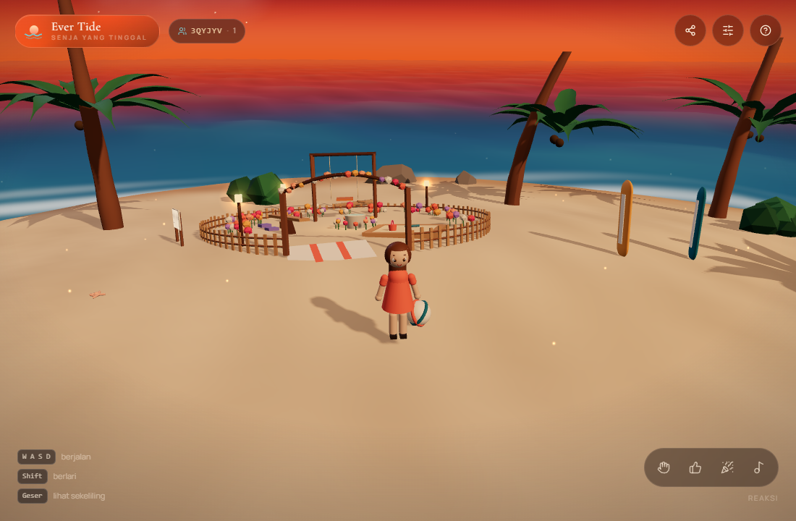
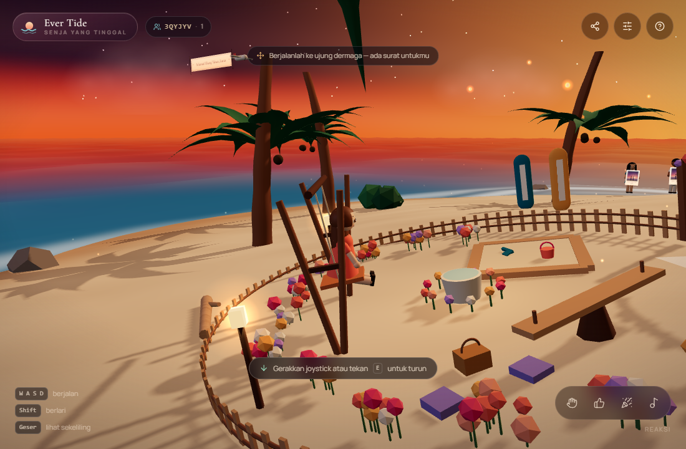
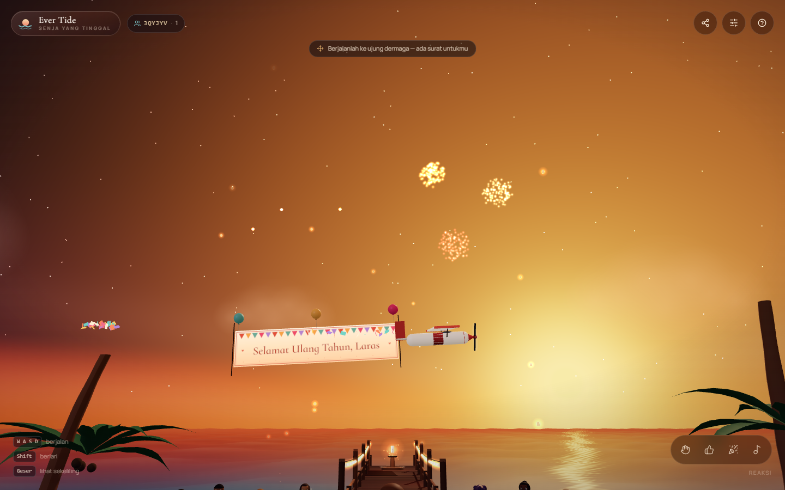
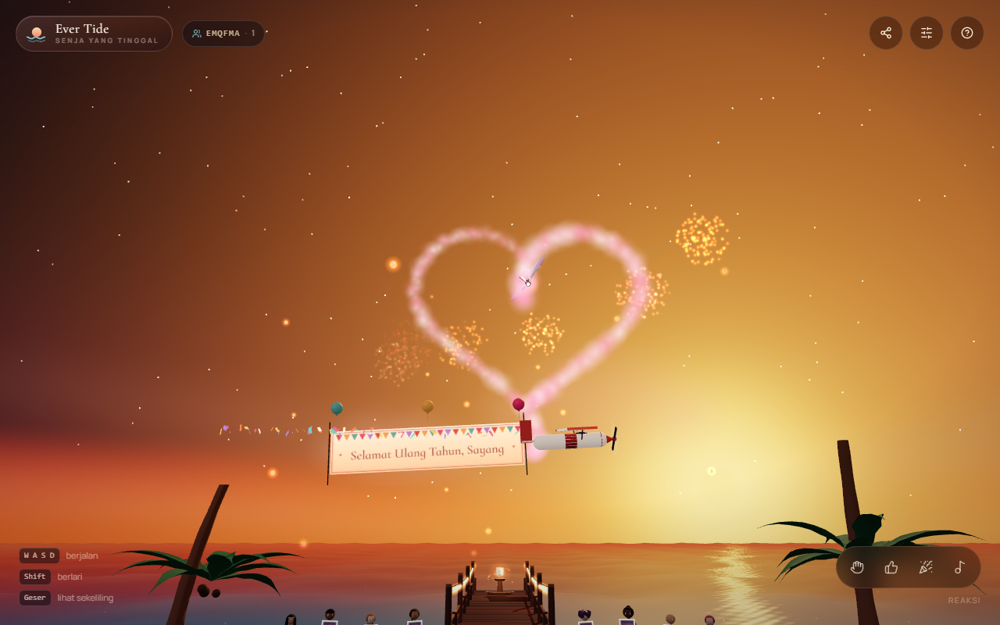
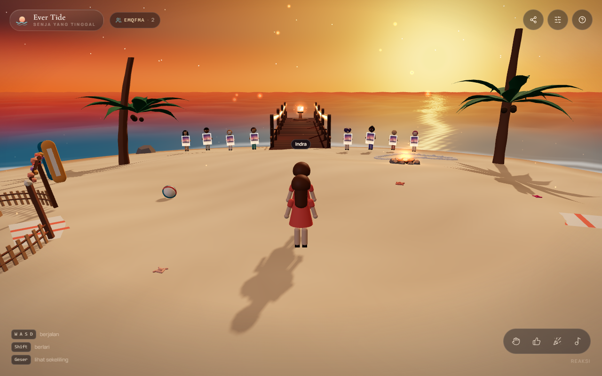

# Ever Tide 🌅

Pengalaman 3D interaktif bertema ulang tahun / anniversary: sebuah pulau tropis
saat matahari terbenam, dengan avatar yang bisa dikustomisasi, dermaga kayu
berlentera, surat digital, pesawat pembawa banner ucapan, kembang api, dan mode
"undang pasangan" lewat tautan.

Dibangun dengan **React 19 + Vite 6 + React Three Fiber + Three.js + Tailwind CSS v4**
dan **Zustand** untuk state. Semua aset (langit, laut, pulau, palem, avatar,
musik, suara ombak) dibangkitkan secara prosedural — **tidak ada file model 3D,
tekstur, atau audio yang diunduh**.











---

## Menjalankan

```bash
npm install
npm run dev      # http://localhost:5173 (hot reload, multiplayer lokal)
npm run build    # hasil produksi di dist/
npm start        # http://localhost:8080 — situs + relay multiplayer online
npm run preview  # pratinjau hasil build (tanpa relay)
```

Butuh Node 18+. `npm start` menjalankan `server/relay.js`, yang menyajikan
`dist/` sekaligus menjadi relay WebSocket — inilah cara main lintas perangkat.
Saat `npm run dev`, isi `VITE_ROOM_WS` (lihat `.env.example`) kalau ingin ikut
online juga.

---

## Alur pemakaian

1. **Intro** — kamera sinematik mengitari pulau, tombol "Masuk ke Pulau".
2. **Kustomisasi** (hanya host) — pilih nama kamu & nama pasangan, lalu atur:
   - bentuk tubuh (mungil / klasik / tinggi)
   - warna kulit (6 pilihan)
   - model rambut (7 gaya) & warna rambut (8 pilihan)
   - warna mata (6 pilihan)
   - pakaian (9 warna) & potongan (gaun / kemeja / tank top)
   - **delapan foto poster** — satu foto untuk tiap warga pulau (opsional)
   - teks surat (opsional — kalau dikosongkan, dipakai surat bawaan)
   - tombol acak untuk menjelajah kombinasi
3. **Dunia 3D** — jelajahi pulau, berjalan ke ujung dermaga, buka surat,
   duduk di ayunan taman.
4. **Bagikan undangan** — tautan berisi nama, pesan, dan tampilan avatar.
   Pasangan cukup membuka tautan itu: ia **langsung masuk** tanpa halaman
   kustomisasi, dan kedelapan foto dikirim ke perangkatnya lewat kanal ruang.

---

## Kontrol

| Aksi | Desktop | Ponsel |
| --- | --- | --- |
| Berjalan | `W A S D` / panah | joystick kiri-bawah |
| Berlari | tahan `Shift` | dorong joystick sampai penuh |
| Lihat sekeliling | klik-tahan & geser | geser satu jari |
| Zoom | roda mouse | — |
| Buka surat | `E` atau klik podium | ketuk podium |
| Reaksi | tombol kanan-bawah | tombol kanan-bawah |

Reaksi yang tersedia: **Melambai**, **Setuju**, **Merayakan**, **Menari**.

---

## Fitur

### Kerumunan NPC & poster foto
Delapan warga pulau berdiri berjajar di depan mulut dermaga, masing-masing
memegang poster polaroid berisi **foto berbeda**. Posisinya simetris dengan
celah di tengah agar jalur ke dermaga tetap terbuka (`NPC_SPOTS` di `palette.js`).

- Halaman kustomisasi punya **delapan slot foto**; ketuk satu kotak untuk
  mengunggah, atau pilih beberapa foto sekaligus (otomatis mengisi slot
  berikutnya). Setiap foto diperkecil ke maks. 560 px lalu disimpan sebagai
  data URL di `localStorage` — tidak ada berkas yang dikirim ke server.
- Slot yang dikosongkan memakai foto pertama, jadi mengunggah satu foto pun
  sudah cukup untuk mengisi kedelapan poster.
- Poster digambar di canvas (`src/scene/posterTexture.js`): bingkai krem, foto
  *cover-fit*, judul script (3 variasi bergantian), nama pasangan, dan warna
  bingkai berbeda tiap NPC.
- Tanpa foto sama sekali, poster diisi ilustrasi senja bergaya potret siluet
  dua orang — tetap terlihat seperti foto, bukan kotak kosong.
- NPC memakai komponen `Avatar` yang sama dengan pemain (pose `hold`), jadi
  wajah, rambut, dan pakaiannya konsisten. Saat pemain mendekat (< 12 unit)
  badan mereka menoleh dan poster terangkat sedikit.
- Pemain tidak bisa menembus NPC (dorongan radial di `Player.jsx`).

### Taman kecil
Taman bermain di sisi barat pulau (`src/scene/Garden.jsx`), lengkap dengan
pagar kayu, gapura bunga, hamparan bunga, bak burung, **ayunan**, jungkat-jungkit,
bak pasir dengan ember & sekop, tikar piknik, lentera, dan papan nama.

- Seluruh taman dimiringkan mengikuti kemiringan tanah (`tilt` di `Garden.jsx`)
  supaya pagar dan tikar menempel di pasir, bukan melayang di satu sisi.
- **Ayunan bisa dinaiki.** Mendekat → prompt "Duduk di ayunan" → `E` atau ketuk.
  Avatar duduk dengan kaki ke depan (`anim="sit"`), ayunan berayun lebih lebar,
  dan kamera ikut mengikuti. Tekan `E` lagi atau dorong joystick untuk turun.
- Jungkat-jungkit bergoyang pelan sendiri; lentera taman menyala hangat.
- Posisi & sudut taman ada di `src/lib/gardenState.js` (`GARDEN`, `SWING`),
  dipakai bersama oleh `Garden.jsx` dan `Player.jsx`.

### Podium surat
Objek interaktif di ujung dermaga (amplop bercahaya). Saat pemain mendekat
(< 3,6 unit) muncul prompt "Buka surat". Surat ditampilkan sebagai kartu kertas
krem dengan tipografi Cormorant Infant + Great Vibes, berisi ucapan yang bisa
kamu tulis sendiri di halaman kustomisasi.

Tombol **"Lihat ke Langit"** di dalam surat memicu rangkaian: kamera mendongak,
kembang api meledak, pesawat pembawa banner melintas, lalu jet hati menyusul
menggambar hati dari asap di langit.

### Pesawat & banner
Pesawat kecil terbang melintasi ufuk sambil menyeret banner bertuliskan
`Selamat Ulang Tahun, <nama pasangan>`. Lintasannya dibuat **dekat, besar, dan
lambat** supaya teksnya benar-benar terbaca dari pantai:

- Jalur `z ≈ -54`, `y ≈ 16`, `x` dari −100 ke +100 — sekali lintas ±50 detik
  (dulu 24 detik dan 1,5× lebih jauh).
- Banner 10,6 × 2,32 satuan pada skala 2,1 (≈22 satuan lebar), dengan tekstur
  canvas **2560 × 560** dan `anisotropy 8` supaya tajam saat diperbesar.
- Desain banner: bingkai ganda, **umbul-umbul** di tepi atas, judul serif,
  hati di kedua ujung, dan titik bintang di bawah. Digambar ulang setelah
  `document.fonts.ready` agar font web ikut terpakai.
- **Tiga balon** diikat ke banner (bergoyang pelan) dan **konfeti** yang jatuh
  dari ekor pesawat — sistem `InstancedMesh` 130 keping dengan warna acak,
  rotasi berputar, gravitasi, dan memudar di akhir umurnya.
- Pesawatnya sendiri: sayap tinggi, ujung sayap merah, kanopi kokpit, hidung
  merah, baling-baling berputar dengan kabut tipis.

### Kembang api
Sistem partikel 720 titik dengan 6 ledakan berurutan, warna di luar palet langit
(magenta, sian, emas, putih, violet) agar tetap terlihat di atas langit oranye,
plus kilatan putih panas di awal ledakan.

### Jet hati
Beberapa detik setelah "Lihat ke Langit", sebuah jet kecil menelusuri kurva hati
parametrik sambil menyemburkan asap — jejaknya membentuk hati raksasa di langit
(`src/scene/HeartJet.jsx`).

- Kurva memakai rumus hati klasik (`x = 16·sin³t`,
  `y = 13cos t − 5cos 2t − 2cos 3t − cos 4t`), diselesaikan dalam **12 detik**,
  lalu jet terbang menjauh ke atas-belakang (bukan ke arah kamera, supaya asapnya
  tidak melewati lensa).
- Asap: 1600 titik dengan shader sendiri — `gl_PointSize` mengikuti jarak kamera
  sehingga gumpalan mengecil saat jauh. Emisi **berbasis waktu** (45 gumpalan/
  detik), jadi kerapatan jejak sama di 30 maupun 120 fps; gumpalan disebar di
  sepanjang lintasan yang baru ditempuh agar jejak tidak putus saat jet melaju.
- Asap hanya disemburkan selama menggambar, tidak saat keluar, supaya bentuk hati
  tetap bersih tanpa ekor.
- Hati diletakkan di atas jalur pesawat banner (`y ≈ 35`) agar banner tidak
  memotong bentuknya.
- Selama hati digambar kamera menahan pandangan ke atas (~20 detik, `SKY.hold`),
  tetapi pemain tetap bisa mengambil alih kapan saja dengan menggeser kamera.
- Semua durasi momen langit (jeda, lama menggambar, lama kamera mendongak) ada di
  `src/lib/skyMoment.js` supaya kamera dan jet tidak pernah berbeda hitungan.

### Pengaturan
- Kualitas grafis **Rendah / Sedang / Tinggi** — mengubah device pixel ratio,
  jumlah segmen air, bayangan, jumlah kunang-kunang & bintang.
- Volume musik latar dan suara ombak.
- Sensitivitas geser kamera.
- Toggle kunang-kunang dan label nama pemain lain.

Preferensi disimpan di `localStorage` (`ever-tide-v1`).

### Audio prosedural
`src/lib/audio.js` membangun seluruh suara dengan Web Audio API:
- **Musik**: pad + arpeggio dari progresi `Aadd9 – F#m7 – Dmaj9 – E6/9`,
  dijadwalkan 12 langkah, melewati convolver reverb.
- **Ombak**: pink noise yang difilter lowpass/highpass dengan dua LFO.
- **SFX**: chime (buka surat), sparkle, whoosh.

Audio baru dimulai setelah interaksi pertama (kebijakan autoplay browser) dan
otomatis di-*suspend* saat tab tidak aktif.

---

## Multi-pemain (online lintas perangkat)

Kehadiran pemain lain ditangani `src/lib/net.js`, dengan dua kanal yang aktif
bersamaan:

- **WebSocket — online lintas perangkat.** `server/relay.js` menyajikan hasil
  build **dan** menjadi relay di `/room?room=KODE`. Karena satu origin, build
  produksi otomatis tersambung tanpa konfigurasi apa pun:

  ```bash
  npm run build
  npm start          # http://localhost:8080 — situs + relay
  ```

  Buka alamat itu dari HP dan laptop (satu jaringan), atau deploy dulu agar
  bisa dari mana saja (lihat di bawah).
- **BroadcastChannel — lokal.** Tetap aktif sebagai jalur cadangan: dua tab di
  browser yang sama langsung saling melihat tanpa server. Berguna saat
  `npm run dev`.

Status kanal terlihat di panel **Bagikan**: "Terhubung ke server online" (hijau)
atau "Mode lokal" (biru). Kalau koneksi putus, klien menyambung ulang otomatis
dengan backoff 1→2→4→8→15 detik (berhenti setelah 5 percobaan).

### Protokol

Server hanya meneruskan JSON ke semua klien lain di ruang yang sama — tanpa
menyimpan apa pun:

| Pesan | Isi |
| --- | --- |
| `{ t:'s', id, n, a, p:[x,y,z], r, an }` | posisi & animasi, 10×/detik |
| `{ t:'ph', id, ph:[dataUrl,…] }` | delapan foto poster, sekali saat bergabung |
| `{ t:'bye', id }` | keluar |

Posisi disinkronkan 10×/detik; pemain yang diam > 4 detik dihapus otomatis, dan
relay membuang koneksi mati lewat ping/pong 30 detik. Batas 16 pemain per ruang
(`MAX_PER_ROOM`) dan pesan maksimal 8 MB (cukup untuk 8 foto poster).

### Deploy supaya bisa main jarak jauh

Situs statis saja tidak cukup — relay butuh proses yang hidup. Satu container
sudah memuat keduanya:

```bash
docker build -t ever-tide .
docker run -p 8080:8080 ever-tide
```

Di Render / Railway / Fly.io: hubungkan repo, pilih **Dockerfile**, selesai —
`PORT` diisi otomatis oleh platform. Setelah itu buka tautan undangan dari
perangkat mana pun, dan keduanya masuk pulau yang sama.

> GitHub Pages **tidak bisa** dipakai untuk relay (statis). Kalau situs tetap
> di-host di Pages, jalankan relay di tempat lain lalu set
> `VITE_ROOM_WS=wss://relay-kamu/room` saat build — lihat `.env.example`.

**Foto poster.** Host mengirim `ph` sekali setelah terhubung dan sekali lagi
setiap ada peserta baru — jadi pasangan yang bergabung belakangan tetap
menerima kedelapan foto. Foto yang diterima disimpan di `localStorage`
(`remotePhotos`) sehingga tetap tampil saat halaman dibuka ulang.

---

## Tautan undangan

`src/lib/share.js` mengubah `{ profile, avatar, room }` menjadi JSON →
base64url → `#/w/<payload>`.

- Kode ruang diturunkan secara deterministik dari nama pasangan, jadi kedua
  orang otomatis masuk ruang yang sama tanpa perlu mengetik kode.
- Saat tautan dibuka, nama, pesan, dan tampilan avatar langsung terisi, dan
  penerima **melewati halaman kustomisasi** — tombolnya berubah menjadi
  "Buka Undangan" dan langsung masuk ke dunia sebagai pasangan.
- Foto poster tidak muat di dalam URL, jadi dikirim lewat kanal ruang saat
  keduanya online. Kalau pasangan membuka tautan saat host belum masuk, poster
  memakai ilustrasi senja sampai host bergabung.

Contoh: `https://situsmu.com/#/w/eyJ2IjoxLCJwIjp7...`

---

## Struktur proyek

```
server/
└─ relay.js                # HTTP statis (dist/) + relay WebSocket /room
src/
├─ App.jsx                 # Canvas R3F + orkestrasi overlay UI
├─ index.css               # design token Tailwind v4 + komponen (.btn, .glass, .slider, …)
├─ store/useStore.js       # Zustand (phase, profile, avatar, settings, ui, runtime)
├─ lib/
│  ├─ content.js           # preset avatar, kerumunan NPC, reaksi, surat bawaan
│  ├─ input.js             # state input mutable (joystick + keyboard), tanpa re-render
│  ├─ playerState.js       # posisi pemain yang dibagikan ke NPC
│  ├─ gardenState.js       # posisi taman, ayunan, dan status dudukan
│  ├─ skyMoment.js         # durasi momen langit (kamera & jet hati)
│  ├─ photo.js             # baca + kecilkan foto unggahan
│  ├─ audio.js             # mesin audio prosedural
│  ├─ share.js             # encode/decode tautan, kode ruang
│  ├─ net.js               # BroadcastChannel + WebSocket opsional
│  ├─ glow.js              # tekstur glow / awan (canvas)
│  └─ textures.js          # tekstur pasir & kayu (canvas)
├─ scene/
│  ├─ palette.js           # arah matahari, warna, tinggi tanah, dermaga, posisi NPC
│  ├─ Scene.jsx            # pencahayaan, kabut, perakitan scene
│  ├─ Sky.jsx              # shader langit + matahari + bintang
│  ├─ Ocean.jsx            # shader air (Gerstner-like, pantulan cermin datar, buih)
│  ├─ Island.jsx           # mesh pulau + properti pantai
│  ├─ Palm.jsx             # geometri palem prosedural
│  ├─ Pier.jsx             # dermaga + lampu tali
│  ├─ Garden.jsx           # taman bermain: pagar, gapura, ayunan, bak pasir
│  ├─ NpcCrowd.jsx         # 8 NPC pemegang poster foto
│  ├─ posterTexture.js     # poster polaroid (canvas) + ilustrasi pengganti
│  ├─ LetterPodium.jsx     # objek surat interaktif
│  ├─ BannerPlane.jsx      # pesawat + banner canvas
│  ├─ HeartJet.jsx         # jet + hati asap di langit
│  ├─ Atmosphere.jsx       # kunang-kunang, lentera langit, kembang api, awan
│  ├─ Avatar.jsx           # avatar prosedural + animasi
│  ├─ Player.jsx           # kontrol orang ketiga + kamera + proximity
│  └─ RemotePlayers.jsx    # avatar pemain lain + interpolasi
└─ components/             # Intro, Customizer, HUD, Joystick, LetterModal,
                           # SettingsPanel, SharePanel, HelpModal
```

---

## Catatan teknis

**Pemisahan arah matahari dan arah cahaya.** `SUN_DIR` rendah di horizon agar
piringan matahari terlihat indah, sedangkan `LIGHT_DIR` dinaikkan (`0.42, 0.8, -1`)
supaya permukaan datar tetap mendapat cahaya. Memakai `SUN_DIR` untuk lampu
membuat seluruh scene menjadi gelap.

**Pantulan air memakai cermin datar.** Arah refleksi dihitung dari normal
`(0,1,0)`, bukan dari normal gelombang — memakai normal gelombang membuat air
terlihat "belang". Riak halus tetap ditambahkan hanya untuk kilau matahari.

**`smoothstep` GLSL tidak boleh dibalik.** `smoothstep(90.0, 18.0, x)` adalah
*undefined behavior*; selalu tulis `1.0 - smoothstep(18.0, 90.0, x)`.

**Winding segitiga pulau.** Ring mesh harus memakai urutan `a,b,c / b,d,c`,
kalau tidak seluruh permukaan pasir ter-*cull* dan pulau terlihat seperti laut.

**Input tanpa React state.** Joystick dan keyboard menulis ke objek mutable
`src/lib/input.js`; `useFrame` membacanya langsung. Ini menghindari re-render
React 60×/detik.

**Kualitas grafis** diatur lewat `QUALITY` di `palette.js` dan diterapkan oleh
komponen `Perf` di `Scene.jsx` (dpr, bayangan, segmen air).

---

## Kustomisasi cepat

| Ingin mengubah | Di mana |
| --- | --- |
| Nama/ucapan bawaan | `src/lib/content.js` → `DEFAULT_PROFILE`, `buildLetter()` |
| Warna & suasana | `src/scene/palette.js` → `COLORS` |
| Arah matahari | `src/scene/palette.js` → `SUN_DIR`, `LIGHT_DIR` |
| Tinggi/lekuk pulau | `src/scene/palette.js` → `groundHeight()` |
| Posisi dermaga & podium | `src/scene/palette.js` → `PIER`, `PODIUM_POS` |
| Posisi 8 NPC | `src/scene/palette.js` → `NPC_SPOTS` |
| Wajah & pakaian NPC | `src/lib/content.js` → `NPC_CROWD` |
| Teks pada poster | `src/lib/content.js` → `POSTER_LINES` |
| Desain poster | `src/scene/posterTexture.js` → `drawBase`, `drawCaption`, `drawFallback` |
| Posisi & ukuran taman | `src/lib/gardenState.js` → `GARDEN`, `SWING` |
| Isi taman (pagar, ayunan, …) | `src/scene/Garden.jsx` |
| Preset avatar | `src/lib/content.js` → `SKIN_TONES`, `HAIR_STYLES`, `OUTFITS`, … |
| Kecepatan jalan/lari | `src/scene/Player.jsx` → `WALK`, `RUN` |
| Progresi musik | `src/lib/audio.js` → `CHORDS` |
| Teks banner | `src/scene/BannerPlane.jsx` → `label` |
| Posisi & ukuran hati di langit | `src/scene/HeartJet.jsx` → `HEART` |
| Durasi momen langit | `src/lib/skyMoment.js` → `SKY` |

---

## Kompatibilitas

- Chrome / Edge / Safari / Firefox terbaru (butuh WebGL2).
- Ponsel: joystick sentuh + geser satu jari; layout responsif sampai 375 px.
- Menghormati `prefers-reduced-motion`.
